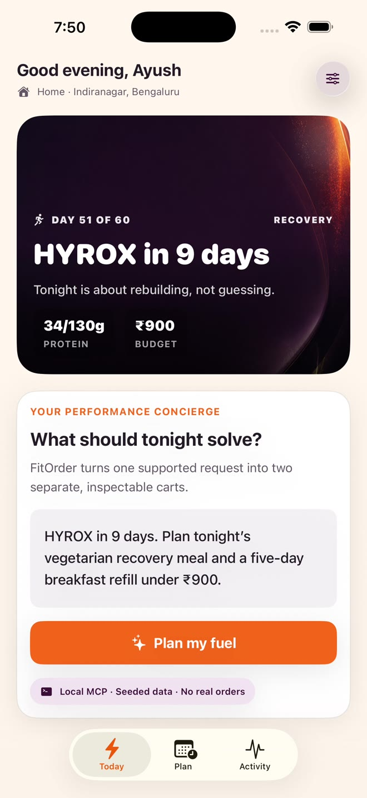
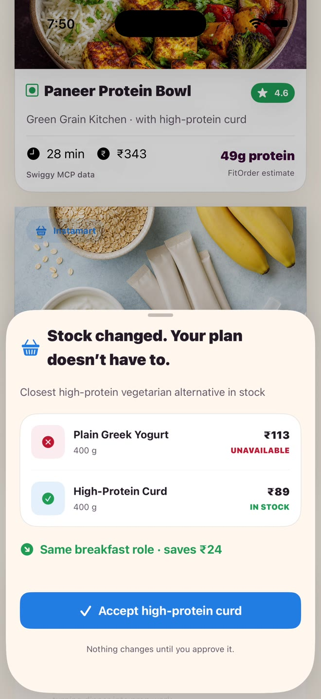
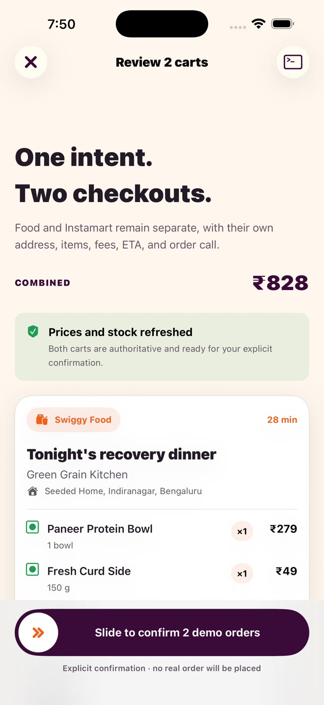
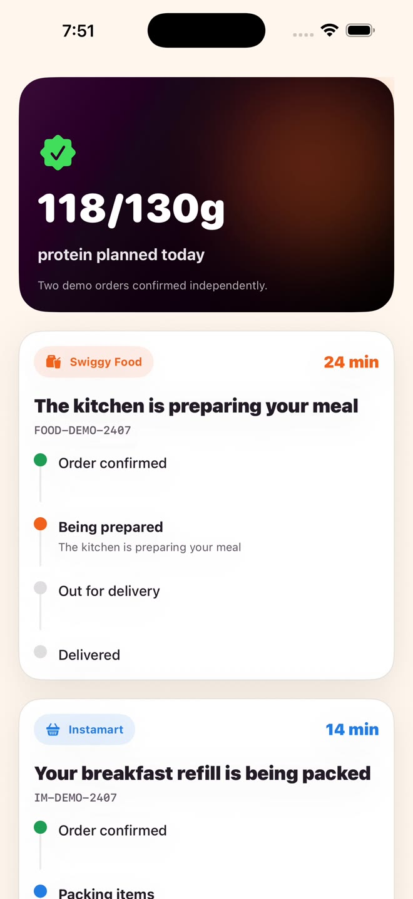
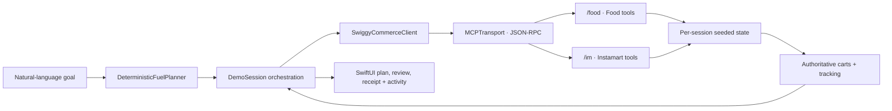

# FitOrder 2.0

### One intent. Two Swiggy surfaces. A repeatable performance-commerce loop.

[](https://developer.apple.com/ios/)
[](https://developer.apple.com/xcode/swiftui/)
[](https://mcp.swiggy.com/builders/)
[](https://github.com/ayushhagarwal/fitorder-swiggy-mcp/actions/workflows/contract-tests.yml)

FitOrder turns one performance-nutrition request into two explicit, inspectable
demo orders across Swiggy Food and Instamart:

> **“HYROX in 9 days. Plan tonight’s vegetarian recovery meal and a five-day
> breakfast refill under ₹900.”**

The app extracts the supported intent on device, orchestrates genuine JSON-RPC
tool calls against a stateful localhost MCP server, handles an out-of-stock
substitution with explicit consent, refreshes two authoritative carts, and tracks
the resulting demo orders independently.

## Watch the demo

https://github.com/user-attachments/assets/a5979dcb-579e-483e-ad99-7e563e820da2

**[▶ Open the captioned 86.5-second demo](https://github.com/user-attachments/assets/a5979dcb-579e-483e-ad99-7e563e820da2)** · [Download the native-resolution master](submission/FitOrder-2.0-Captioned.mp4) · [Captions and narration source](submission/)

> **AI narration disclosure:** The video voiceover is AI-generated from the
> included human-written script. Pronunciation and spoken accuracy may vary.
> The burned-in captions, on-screen seeded data, tests, and source code are the
> authoritative references.

<p align="center">
  
  
  
  
</p>

## Why this is interesting

- **Performance context becomes commerce intent.** Diet, recovery purpose,
  timing, refill duration, and budget are extracted by a deterministic planner.
- **Food and Instamart remain separate.** Each surface retains its own address,
  items, stock, savings, fees, ETA, cart revision, checkout, and tracking state.
- **The server is the commerce source of truth.** Every displayed price, stock
  result, fee, discount, ETA, cart total, and order state comes from MCP output.
- **Agentic does not mean autonomous checkout.** A ₹24 yogurt substitution and
  both demo orders require visible, explicit approval.
- **The orchestration is inspectable.** An in-app MCP receipt shows stable tool
  order, real localhost latency, result summaries, and masked session IDs.
- **Failure paths are first-class.** Offline, changed-cart, and ambiguous
  placement scenarios are deterministic and recoverable.

The golden-path carts are **₹343 Food + ₹485 Instamart = ₹828**, leaving ₹72
inside the requested ₹900 budget.

## Architecture



Canonical golden-path calls:

```text
Shared       get_addresses
Food         search_menu → get_restaurant_menu → update_food_cart
             → fetch_food_coupons → apply_food_coupon → get_food_cart
Instamart    your_go_to_items → search_products → update_cart → get_cart
Confirm      get_food_cart + get_cart → explicit slide confirmation
Placement    place_food_order + checkout
Tracking     track_food_order + track_order
```

The sequences follow Swiggy’s published
[Food ordering recipe](https://mcp.swiggy.com/builders/docs/build/recipes/order-food/)
and
[Instamart ordering recipe](https://mcp.swiggy.com/builders/docs/build/recipes/order-groceries/).

See [the architecture and trust notes](docs/ARCHITECTURE.md) for the state
machine, reliability scenarios, and source-of-truth boundaries.

## Run locally

Requirements:

- Xcode 26.x and an iOS 26 simulator
- Node.js 20 or newer
- No API keys, production credentials, package installation, or external model

Start the dependency-free local MCP server:

```sh
# Terminal 1
cd demo-server
npm start
```

Open `swiggy-mcp.xcodeproj`, select the `swiggy-mcp` scheme, and run on an iPhone
Pro simulator. The app connects to `http://127.0.0.1:8787`.

The settings control on Today exposes a one-tap reset and four seeded scenarios:
golden path, server unavailable, cart changed, and ambiguous checkout.

If the app shows the offline state, confirm the server is listening on port 8787
and use **Retry**. Use **Reset seeded demo** before a fresh recording or test run.

## Verify

Server contracts:

```sh
cd demo-server
npm test
```

iOS unit and golden-path UI tests:

```sh
DEVELOPER_DIR=/Applications/Xcode.app/Contents/Developer \
xcodebuild test \
  -project swiggy-mcp.xcodeproj \
  -scheme swiggy-mcp \
  -destination 'platform=iOS Simulator,name=iPhone 17 Pro Max'
```

The verified submission build passes:

- **6 Swift unit tests** for planning, budget math, canonical tool order,
  substitution consent, authoritative refresh, and recovery behavior
- **1 end-to-end UI test** from reset through independent tracking
- **8 Node contract tests** covering MCP initialization, tools, carts, stock,
  confirmation gating, reset, scenarios, and tracking
- Large Dynamic Type and Reduce Motion golden-path checks

## Repository map

```text
swiggy-mcp/             SwiftUI product, design system, orchestration and models
swiggy-mcpTests/        Deterministic planner and commerce-state unit tests
swiggy-mcpUITests/      Golden-path UI automation
demo-server/            Dependency-free stateful Food + Instamart MCP server
docs/                   Architecture notes and reviewer media
submission/             Final captioned demo, captions and narration source
```

## Demo and data disclosure

FitOrder is an independent prototype prepared for the
[Swiggy Builders program](https://mcp.swiggy.com/builders/). It is not a
production Swiggy client and is not presented as an official Swiggy product.

All names, addresses, catalog items, availability, prices, carts, and order IDs
are visibly seeded demo data. No real order is placed and no customer PII is
persisted. Nutrition values are labelled **FitOrder estimate**; commerce values
are labelled **Swiggy MCP data**.

The app uses no AI model at runtime. Its planner is deterministic and intentionally
supports the published golden request. The video narration is AI-generated from
the checked-in script and may contain pronunciation or spoken inaccuracies.
Illustrative meal, pantry, hero, launch, and app-icon imagery was generated
specifically for this prototype; no production catalog imagery is bundled.
