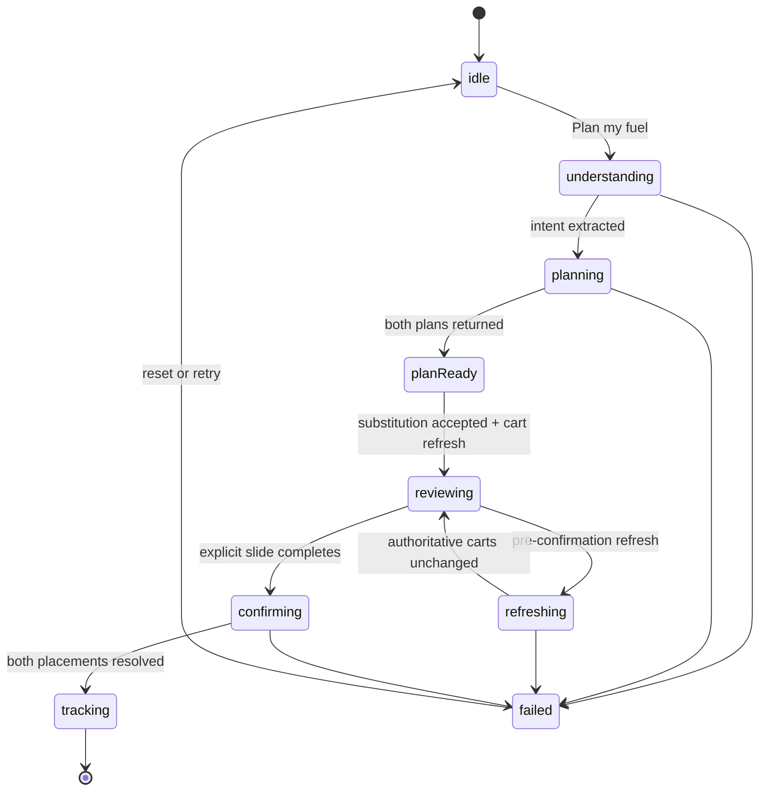

# FitOrder architecture and trust model

FitOrder is a deterministic product demo with a real local orchestration
boundary. Swift owns intent and presentation state; the Node MCP server owns
commerce state.

## Runtime layers

| Layer | Responsibility |
| --- | --- |
| `DeterministicFuelPlanner` | Parses the published golden request into a typed `FuelIntent`; it does not claim to be an LLM. |
| `DemoSession` | Owns phase transitions, cancellation, trace state, substitution consent, authoritative refresh, confirmation gating, and recovery. |
| `SwiggyCommerceClient` | Exposes typed Food and Instamart domain operations to the app. |
| `MCPTransport` | Sends cancellable JSON-RPC with timeouts, per-server sessions, typed errors, and masked identifiers. |
| Local MCP server | Owns per-session catalog, stock, coupons, carts, order placement, and tracking state. |
| SwiftUI views | Render server-returned commerce state and FitOrder-labelled nutrition estimates. |

## Session state machine



## Source-of-truth boundaries

| Value | Authority | UI label |
| --- | --- | --- |
| Price, stock, discount, fee, tax, ETA and cart total | Local MCP response | `Swiggy MCP data` |
| Cart revision, order ID and tracking state | Local MCP response | `Swiggy MCP data` |
| Protein and recovery rationale | Deterministic FitOrder estimate | `FitOrder estimate` |
| Address and customer identity | Seeded in-memory demo state | Persistent local-demo disclosure |

The golden path produces:

```text
Food cart       ₹343
Instamart cart  ₹485
Combined        ₹828
Budget cap      ₹900
Remaining        ₹72
```

## Reliability scenarios

| Scenario | Expected behavior |
| --- | --- |
| Golden path | One stock substitution, two refreshed carts, explicit confirmation, independent tracking. |
| Server unavailable | No silent Swift fixture fallback; a polished retry state is shown. |
| Cart changed | The authoritative difference is surfaced and confirmation is revoked until reconfirmed. |
| Ambiguous checkout | Order history is queried before any retry, preventing duplicate placement. |

## Privacy and safety

- No production OAuth, API keys, or Swiggy credentials
- No external AI/model call at runtime
- No real checkout or customer account
- No persistence of address, cart payloads, or raw MCP session IDs
- Masked session identifiers in the receipt
- Explicit confirmation gates both placement calls
- Seeded data can be restored through `/demo/reset`

## Video provenance

The checked-in submission video is a deterministic Simulator recording with
burned-in captions. Its narration is AI-generated from
`submission/FitOrder-Voiceover.txt`; pronunciation and spoken accuracy may vary.
The captions, visible seeded data, tests, and implementation are authoritative.
